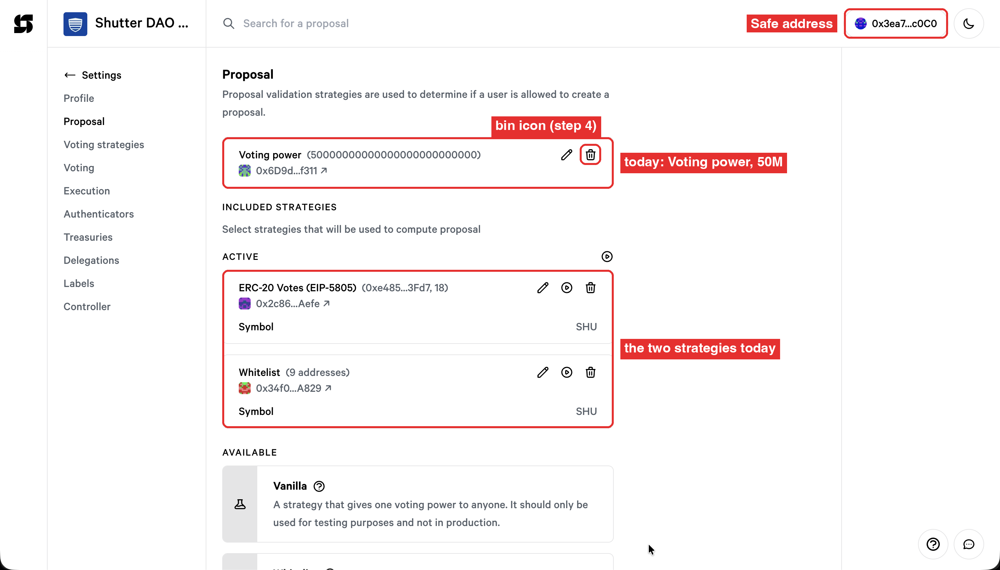
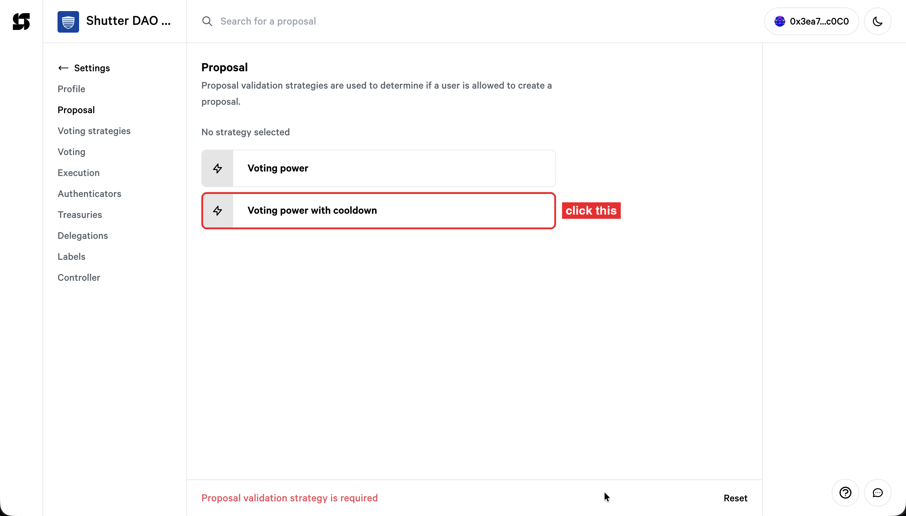
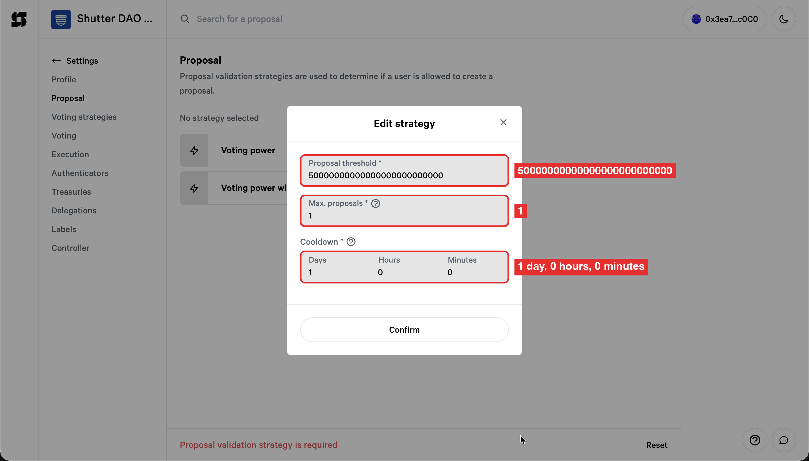
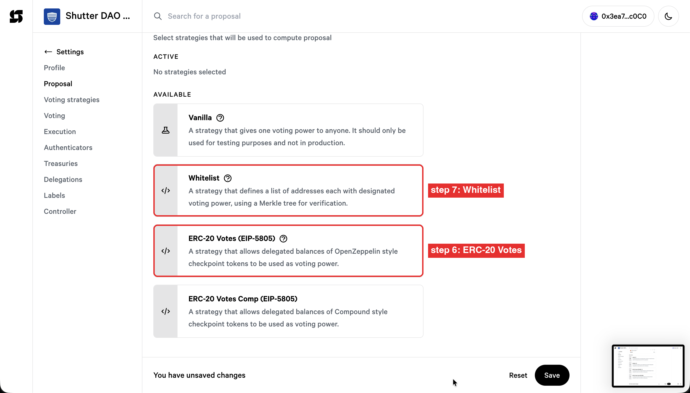
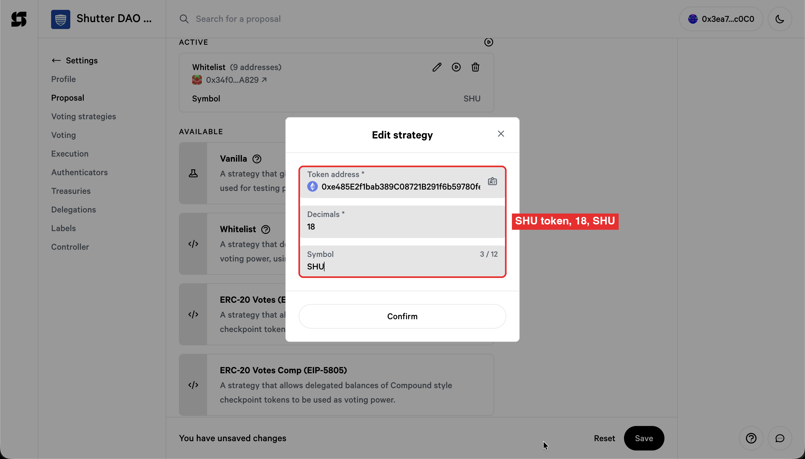
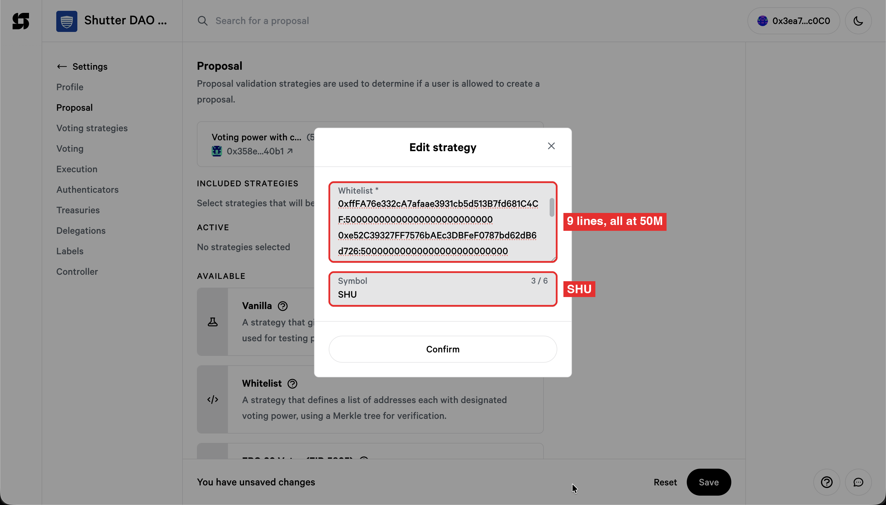
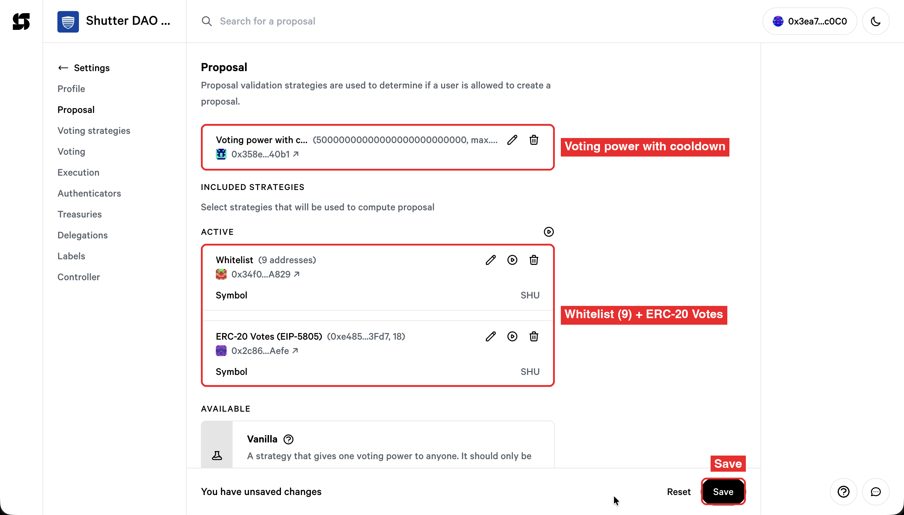

# Limit proposals to one per address every 24 hours

**Space:** [Shutter DAO 0x36 on snapshot.box](https://snapshot.box/#/eth:0x594EB60b35C4E91A06a5df988e0504f7463cB769)
**Signer:** Security Council Safe `0x3ea731dAF66D6A7980549f90152CD9A761B9c0C0` (5 of 8)

You replace the space's proposal validation on one settings page. The change is saved in
one transaction:

| | Now | New |
|---|---|---|
| Proposal validation | Voting power | **Voting power with cooldown** |
| Proposal threshold | `50000000000000000000000000` (50M) | `50000000000000000000000000` (50M), unchanged |
| Max. proposals | none | `1` |
| Cooldown | none | 1 day (24 hours) |
| ERC-20 Votes strategy (SHU) | included | included, unchanged |
| Whitelist (9 addresses at 50M) | included | included, unchanged |

After the change, each address can create **one proposal every 24 hours**, counted from
its last proposal. This applies to everyone, including the nine whitelisted members:

- A proposal that is vetoed or cancelled still counts. Its author must wait 24 hours.
- Editing a proposal before voting starts does not count.
- One author's proposal does not block anyone else.
- Everyone starts fresh when the change is executed.

**You must add both strategies again.** The page cannot change the validation type in
place. When you remove the current validation, its two strategies are removed with it.
If you leave out the whitelist, the nine whitelisted members can no longer propose. If
you leave out ERC-20 Votes, SHU holders can no longer propose.

The new validation contract is an official Snapshot X deployment
(`0x358e4Ba219CC1e1c7084A14c3a504772acfc40b1`). Nobody can change its code or its rules.
We tested this change on a copy of the live space. These steps were rehearsed on
testnet.snapshot.box on 18 November 2026.

## First signer: create the transaction

1. On [app.safe.global](https://app.safe.global), open the Security Council Safe and
   click **WalletConnect**.
2. On [snapshot.box](https://snapshot.box/#/eth:0x594EB60b35C4E91A06a5df988e0504f7463cB769),
   click **Connect wallet** and choose **WalletConnect**. Paste the link into the Safe.
   Check that the top right shows `0x3ea7…c0C0`, not your own wallet.
3. Go to **Settings** and then **Proposal**. The page shows **Voting power
   (50000000000000000000000000)** with the strategies **ERC-20 Votes (EIP-5805)** and
   **Whitelist (9 addresses)**. If it shows anything else, stop and report it in the
   Council channel.

   

   *Check the boxes: the Safe address at the top right, "Voting power" with 50M, and the
   two strategies. The bin icon is the one you click in step 4.*
4. Click the bin icon on **Voting power**. The validation and its strategies disappear,
   and buttons for the available validations appear. The red text "Proposal validation
   strategy is required" at the bottom is expected until step 5.

   
5. Click **Voting power with cooldown**. Fill in the three fields, then click **Confirm**:

   | Field | Value |
   |---|---|
   | Proposal threshold | `50000000000000000000000000` |
   | Max. proposals | `1` |
   | Cooldown | `1` days, `0` hours, `0` minutes |

   

   *Check that the threshold has 26 digits: 5 followed by 25 zeros.*

6. Under **Included strategies**, the list is empty. Scroll down to **Available** and
   click **ERC-20 Votes (EIP-5805)**. Do not pick **ERC-20 Votes Comp (EIP-5805)**.

   

   Fill in the fields, then click **Confirm**:

   | Field | Value |
   |---|---|
   | Token address | `0xe485E2f1bab389C08721B291f6b59780feC83Fd7` |
   | Decimals | `18` |
   | Symbol | `SHU` |

   

   *The token address field is cut off on screen. Check that it starts with `0xe485E2f1`
   and ends with `C83Fd7`.*

7. Under **Available**, click **Whitelist**. Paste the text below into **Whitelist**,
   set **Symbol** to `SHU`, then click **Confirm**.

   ```
   0xffFA76e332cA7afaae3931cb5d513B7fd681C4CF:50000000000000000000000000
   0xe52C39327FF7576bAEc3DBFeF0787bd62dB6d726:50000000000000000000000000
   0xDffDb9BeeA2aB3151BcBcf37a01EE8726F22ed94:50000000000000000000000000
   0x61C2dAE896f93e5f0f10425914CE7868eE8A0e44:50000000000000000000000000
   0x06c2c4dB3776D500636DE63e4F109386dCBa6Ae2:50000000000000000000000000
   0x1F3D3A7A9c548bE39539b39D7400302753E20591:50000000000000000000000000
   0x057928bc52bD08e4D7cE24bF47E01cE99E074048:50000000000000000000000000
   0x302a65C78da31B9ec333c62B90d35D2e70fb3f4E:50000000000000000000000000
   0x0f853a4c50763e0553Ac44E2546C0178B417c0Ba:50000000000000000000000000
   ```

   

   *The field shows only the first two lines. Scroll inside it to check all nine.*

8. The page should now show:

   - **Voting power with cooldown (50000000000000000000000000, max. 1, 1d cooldown)**.
     The page may cut this text off after "max.". The Safe check below confirms the
     full values.
   - **ERC-20 Votes (EIP-5805)** with `0xe485…3Fd7` and `18`
   - **Whitelist (9 addresses)**

   

   *In this screenshot the whitelist was added before ERC-20 Votes, so it is listed
   first. If you follow the order of this guide, ERC-20 Votes is listed first. Both
   orders work.*

   Click **Save**. If something looks wrong, click **Reset** and start again from step 4.
   The page waits a few seconds while it builds the whitelist and uploads the metadata.
9. In the Safe, check the transaction (see below), sign it and tell the other signers.

## Other signers

Open the Safe, go to **Transactions** and then **Queue**. Check the transaction and sign
it. The 5th signer clicks **Execute**.

## Check before signing

- **To:** `0x594EB60b35C4E91A06a5df988e0504f7463cB769`
- **Value:** 0
- **Method:** `updateSettings`
- **Proposal validation strategy address:** `0x358e4Ba219CC1e1c7084A14c3a504772acfc40b1`
- **Its params contain all of these values:**
  - `15180` (the cooldown, 86400 seconds, in hex)
  - `295be96e64066972000000` (50M in hex)
  - `2c8631584474e750cedf2fb6a904f2e84777aefe` (the ERC-20 Votes strategy)
  - `e485e2f1bab389c08721b291f6b59780fec83fd7` (the SHU token)
  - `34f0afff5a739bbf3e285615f50e40ddaaf2a829` (the whitelist strategy)
  - `4a4e8bc114ebb3175a1a343b5886de63340c4991cbeed4a56d3462e7d60b6869` (the whitelist)
- **The proposal validation strategy metadata URI** starts with `ipfs://` and is not empty.
