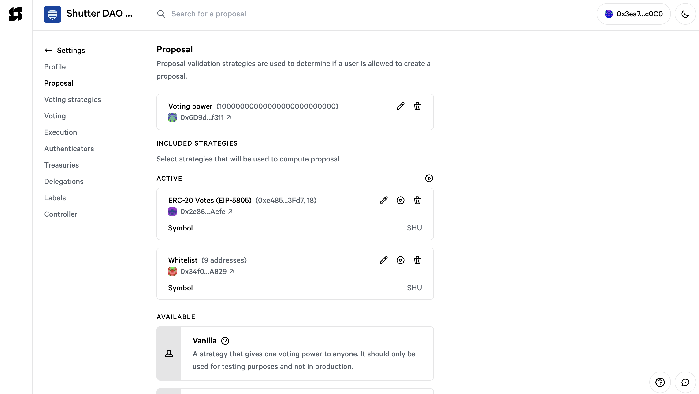
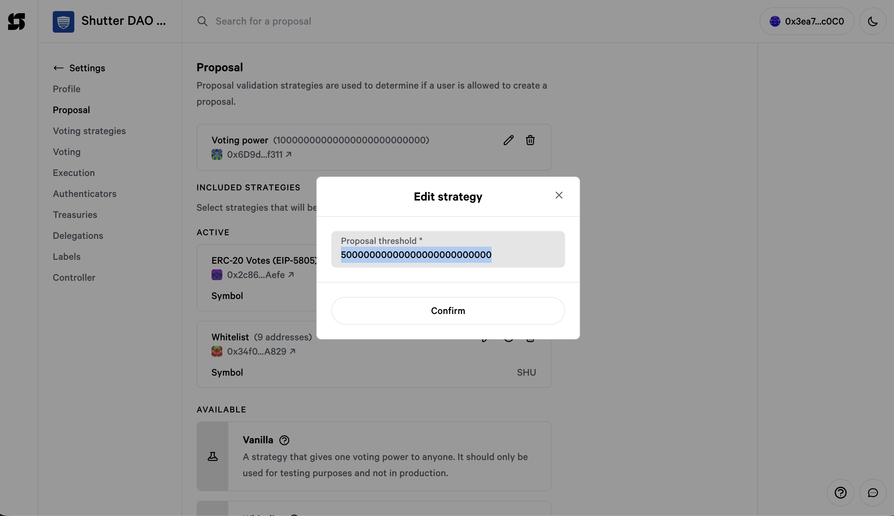
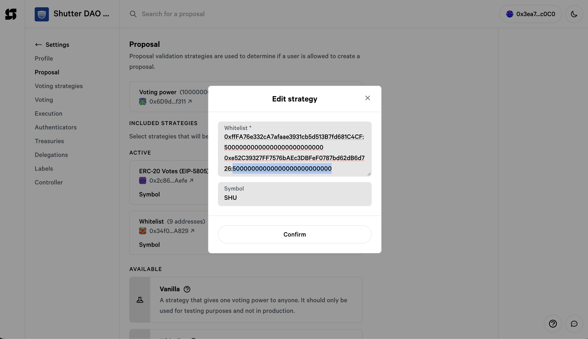
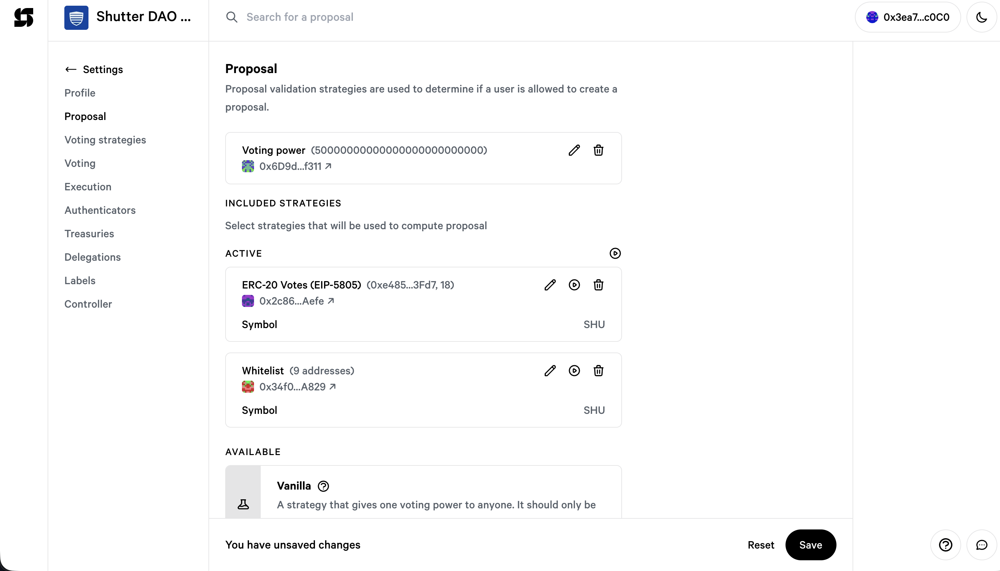

# Raise the proposal threshold from 10M to 50M SHU

**Space:** [Shutter DAO 0x36 on snapshot.box](https://snapshot.box/#/eth:0x594EB60b35C4E91A06a5df988e0504f7463cB769)
**Signer:** Security Council Safe `0x3ea731dAF66D6A7980549f90152CD9A761B9c0C0` (5 of 8)

You make two edits on one settings page. Both are saved in one transaction:

| | Now | New |
|---|---|---|
| Proposal threshold | `10000000000000000000000000` (10M) | `50000000000000000000000000` (50M) |
| Each of the 9 whitelist addresses | `10000000000000000000000000` (10M) | `50000000000000000000000000` (50M) |

**You must make both edits.** If you only change the threshold, the 9 whitelisted
addresses stay at 10M and can no longer propose.

We tested this exact change on a copy of the live space. Everything worked as expected.

## First signer: create the transaction

1. On [app.safe.global](https://app.safe.global), open the Security Council Safe and
   click **WalletConnect**.
2. On [snapshot.box](https://snapshot.box/#/eth:0x594EB60b35C4E91A06a5df988e0504f7463cB769),
   click **Connect wallet** and choose **WalletConnect**. Paste the link into the Safe.
   Check that the top right shows `0x3ea7…c0C0`, not your own wallet.
3. Go to **Settings** and then **Proposal**.

   

4. Click the pencil on **Voting power**. In **Proposal threshold**, replace the value
   with the number below, then click **Confirm**.

   ```
   50000000000000000000000000
   ```

   

5. Click the pencil on **Whitelist (9 addresses)**. Each line is `address:amount`. Change
   the amount on every line to `50000000000000000000000000`, as shown for the first two
   lines in the picture. The easiest way is to replace the whole field with the text
   below. Leave **Symbol** as `SHU`, then click **Confirm**.

   

   ```
   0xffFA76e332cA7afaae3931cb5d513B7fd681C4CF:50000000000000000000000000
   0xe52C39327FF7576bAEc3DBFeF0787bd62dB6d726:50000000000000000000000000
   0xDffDb9BeeA2aB3151BcBcf37a01EE8726F22ed94:50000000000000000000000000
   0x61C2dAE896f93e5f0f10425914CE7868eE8A0e44:50000000000000000000000000
   0x06c2c4dB3776D500636DE63e4F109386dCBa6Ae2:50000000000000000000000000
   0x1F3D3A7A9c548bE39539b39D7400302753E20591:50000000000000000000000000
   0x057928bc52bD08e4D7cE24bF47E01cE99E074048:50000000000000000000000000
   0x302a65C78da31B9ec333c62B90d35D2e70fb3f4E:50000000000000000000000000
   0x0f853a4c50763e0553Ac44E2546C0178B417c0Ba:50000000000000000000000000
   ```

6. The page should now show **Voting power (50000000000000000000000000)** and
   **Whitelist (9 addresses)**. Click **Save**. If something looks wrong, click **Reset**
   and start again from step 4.

   

7. In the Safe, check the transaction (see below), sign it and tell the other signers.

## Other signers

Open the Safe, go to **Transactions** and then **Queue**. Check the transaction and sign
it. The 5th signer clicks **Execute**.

## Check before signing

- **To:** `0x594EB60b35C4E91A06a5df988e0504f7463cB769`
- **Value:** 0
- **Method:** `updateSettings`
- **Proposal validation strategy address:** `0x6D9d6D08EF6b26348Bd18F1FC8D953696b7cf311`
- **Its params contain:**
  - `295be96e64066972000000` (50M in hex)
  - `4a4e8bc114ebb3175a1a343b5886de63340c4991cbeed4a56d3462e7d60b6869` (the new whitelist)

If either value is missing, **do not sign**. Report it in the Council channel.


